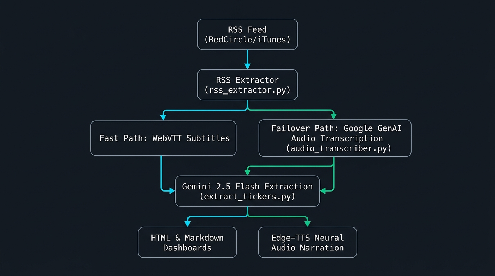

# InvestTalk Podcast Summaries & Stock Verdicts Tracker

I'm an avid listener to the [InvestTalk](http://www.kppfinancial.com/investtalk) show — a weekday hour-long podcast by KPP Financial that recaps the day's market, shares educational market insights, and answers listener call-in questions with value-oriented stock analysis. I usually listen to this while driving, but wanted an automated way to track episode takeaways and stock ticker discussions.

This repository automates extracting and summarizing each episode and publishes to **[https://yafaheem.github.io/investtalk_podcast_summary/](https://yafaheem.github.io/investtalk_podcast_summary/)** so you can quickly see the key educational topic, every stock ticker discussed, the hosts' verdict, and the underlying reasoning without having to spend an hour listening.

---

## Architecture & Ingestion Workflow

<div align="center">
  
</div>

```text
+--------------------------------------------------------+
|             RSS Feed (RedCircle / iTunes)              |
+--------------------------------------------------------+
                           |
                           v
+--------------------------------------------------------+
|                   rss_extractor.py                     |
|  - Resolve air-date timezone (America/Los_Angeles)     |
|  - Parse <podcast:transcript> & <enclosure> audio tags |
+--------------------------------------------------------+
                           |
            +--------------+--------------+
            |                             |
      (WebVTT found)               (WebVTT missing)
            |                             |
            v                             v
  +--------------------+     +-----------------------------------+
  |  Fast Path (VTT)   |     |      Failover Path (Audio MP3)    |
  |  clean_vtt()       |     |        audio_transcriber.py       |
  |  - Strip headers   |     |  1. Download <enclosure> stream   |
  |  - Format turns    |     |  2. Upload via GenAI File API     |
  +--------------------+     |  3. Gemini 2.5 Flash Audio STT    |
            |                |  4. Delete remote File API audio  |
            |                +-----------------------------------+
            |                                 |
            +----------------+----------------+
                             |
                             v
+--------------------------------------------------------+
|                   extract_tickers.py                   |
|  - Google GenAI SDK: Gemini 2.5 Flash                  |
|  - Structured Ticker Extraction (Verdicts & Reasons)   |
|  - Educational Topic Summary Generation                |
+--------------------------------------------------------+
                             |
            +----------------+----------------+
            |                                 |
            v                                 v
+------------------------+       +------------------------+
|  Dashboards & Notes    |       |   Driving Mode Audio   |
|  - summary.html (Jinja)|       |   - Edge-TTS Neural    |
|  - summary.md          |       |     Narration (MP3)    |
|  - summaries_data.json |       |                        |
+------------------------+       +------------------------+
```

### 1. Dual-Path Transcript Ingestion & Failover
- **Primary / Fast Path (WebVTT):** When podcast publishers include `<podcast:transcript>` WebVTT tags, the pipeline downloads and parses the subtitle stream instantaneously with zero token overhead.
- **Failover Path (Google GenAI Multimodal Audio):** If WebVTT transcripts are delayed or missing from the RSS feed, the pipeline automatically fails over to `audio_transcriber.py`. It streams the episode's MP3 from the `<enclosure>` tag, uploads it via the **Google GenAI File API**, and transcribes the audio into structured speaker turns using **Gemini 2.5 Flash**. Remote GenAI files and local temporary downloads are automatically cleaned up in `finally` blocks.

### 2. Powered by the Google GenAI SDK (`google-genai`)
The system leverages the official **Google GenAI Python SDK** (`google-genai`):
- **Multimodal Audio Processing:** Uses `client.files.upload()` and `client.models.generate_content()` to process full-length podcast audio streams without requiring local heavyweight dependencies (like PyTorch or local Whisper models).
- **Structured LLM Extraction:** Uses `gemini-2.5-flash` with structured JSON output configuration (`response_mime_type="application/json"`) to reliably extract ticker symbols, primary listing exchanges, verdicts (**Buy**, **Sell**, **Hold**, **Neutral**, **Watchlist**), and host reasoning.
- **Topic Distillation:** Employs prompt engineering to isolate the main educational topic while excluding individual caller Q&A.

---

## Features

- **Live Web Dashboard:** Published automatically to [GitHub Pages](https://yafaheem.github.io/investtalk_podcast_summary/).
- **Automated RSS Feed Processing:** Dynamically discovers the latest feed URL via iTunes and RedCircle, parses episode metadata, and extracts air dates.
- **Air-Date Timezone Correction:** Accurately converts UTC timestamps to local Pacific Time (`America/Los_Angeles`), matching the live broadcast date.
- **Robust Audio Failover:** Guaranteed transcription even when the publisher delays WebVTT subtitle uploads.
- **'Driving Mode' Audio Summaries:** Pre-renders natural neural narration (`.mp3`) using Microsoft `edge-tts` (`en-US-AriaNeural`) with an interactive player inside the HTML dashboard.
- **Google Finance Hyperlinks:** Automatically maps stock tickers to their primary exchange (`NASDAQ`, `NYSE`, `OTCMKTS`) and creates clickable Google Finance quote links.
- **Optimized Local Caching:** Persists historical runs inside `summaries_data.json` to prevent duplicate API queries and conserve quota.
- **HTML & Markdown Dashboards:** Automatically updates `summary.md` and a styled, responsive `summary.html` dashboard using **Jinja2** templating.

---

## Directory Structure

```text
.
├── extract_tickers.py          # Main orchestration pipeline (RSS -> Transcript -> Gemini -> Dashboards)
├── audio_transcriber.py        # Modular Google GenAI File API audio transcription engine & CLI
├── rss_extractor.py            # RSS feed fetching, enclosure/VTT parsing, and timezone normalization
├── blacklist.txt               # False-positive macro ticker abbreviation blacklist (e.g. AI, US, GDP)
├── summaries_data.json         # Local JSON database of compiled episode summaries and verdicts
├── templates/
│   └── summary_template.html   # Jinja2 layout for summary.html dashboard with audio player
├── tests/
│   ├── test_extract_tickers.py  # Unit tests for RSS parsing, date conversion, and extraction logic
│   └── test_audio_transcriber.py# Unit tests for audio downloading, File API uploads, and cleanup
├── architecture_flowchart.png  # Workflow architecture flowchart diagram
├── summary.md                  # Unified cumulative Markdown summaries output
├── summary.html                # Unified cumulative HTML summaries dashboard
└── requirements.txt            # Project dependencies (google-genai, Jinja2, edge-tts, etc.)
```

---

## Installation & Setup

1. **Clone the repository** and navigate to the project directory:
   ```bash
   git clone https://github.com/yafaheem/investtalk_podcast_summary.git
   cd investtalk_podcast_summary
   ```

2. **Set up a Python Virtual Environment:**
   ```bash
   python3 -m venv venv
   source venv/bin/activate
   ```

3. **Install Dependencies:**
   ```bash
   venv/bin/python3 -m pip install -r requirements.txt
   ```

4. **Environment Configuration:**
   Create a `.env` file in the root directory and add your Google Gemini API key:
   ```env
   GEMINI_API_KEY="your-gemini-api-key-here"
   ```

---

## Usage

### 1. Run the Main Pipeline
```bash
# Process the latest episode from RSS
venv/bin/python3 extract_tickers.py

# Process a specific air date (YYYY-MM-DD)
venv/bin/python3 extract_tickers.py --date 2026-08-31

# Process a custom date range
venv/bin/python3 extract_tickers.py --start-date 2026-08-20 --end-date 2026-08-31

# Force re-extraction (ignore cache)
venv/bin/python3 extract_tickers.py --date 2026-08-31 --force

# Dry-run mode (skips LLM and remote audio downloads)
venv/bin/python3 extract_tickers.py --dry-run
```

### 2. Standalone Audio Transcriber CLI
You can also transcribe any podcast audio URL or local audio file directly using the standalone CLI:
```bash
# Transcribe from a remote audio URL
venv/bin/python3 audio_transcriber.py --source "https://example.com/episode.mp3" --output transcript.txt

# Transcribe a local audio file
venv/bin/python3 audio_transcriber.py --source "path/to/podcast.mp3" --output transcript.txt
```

---

## Running Automated Tests

Run the full unit test suite using the virtual environment interpreter:

```bash
venv/bin/python3 -m unittest discover -s tests
```
