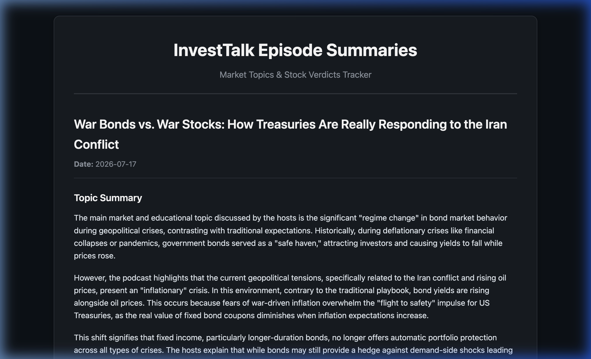

# InvestTalk Podcast Summaries & Stock Verdicts Tracker

I'm an avid listener to the http://www.kppfinancial.com/investtalk show - a weekday hourlong show that recaps the days market and follows a value-oriented investment process. The show also has listeners who can call in and ask their questions including input on stocks. 

This repo helps when I miss the show and don't have an hour to spend. It fetches the transcript, summarizes it and lists out all the stock tickers discussed, verdict of the podcast hosts and the underlying reason.

---

## Dashboard Preview

Here is a visual snapshot of the generated `summary.html` dashboard tracking the episode summaries and stock ticker verdicts:

<div align="center">
  <div style="border: 1px solid #30363d; border-radius: 12px; overflow: hidden; max-width: 800px; box-shadow: 0 8px 24px rgba(0,0,0,0.5); margin: 1.5rem 0;">
    
  </div>
</div>

---

## Features

- **Automated RSS Feed Processing:** Automatically looks up the latest feed URL from iTunes and RedCircle, parses episode metadata, and extracts dates.
- **Air-Date Timezone Correction:** Converts the feed's UTC publication timestamps to local Pacific Time (the actual air date of the live show), avoiding date-shift collisions.
- **Transcript Extraction & Sanitization:** Downloads and parses standard WebVTT subtitles, scrubbing timestamps and formatting markers to produce a clean text transcript.
- **Gemini LLM Summary & Verdict Generation:** Analyzes transcripts using the Gemini API to identify:
  - The main educational and market topics discussed.
  - Ticker-by-ticker verdicts (**Buy**, **Sell**, **Hold**, **Neutral**, or **Watchlist**).
  - The underlying justification provided by the hosts.
- **Optimized Local Caching:** Saves historical runs inside `summaries_data.json` to prevent duplicate LLM queries, conserve API quota, and build a cumulative historical database.
- **HTML & Markdown Dashboards:** Generates updated, unified summaries in `summary.md` and a styled, responsive `summary.html` dashboard using **Jinja2** templating.

---

## Directory Structure

```text
.
├── extract_tickers.py       # Main entry point (orchestrates API, LLM, and rendering)
├── rss_extractor.py         # Submodule for feed fetching, XML parsing, and date shifts
├── blacklist.txt            # List of false-positive tickers to ignore (e.g. AM, PM, OR)
├── latest_metadata.json     # Cache of the last processed feed state
├── summaries_data.json      # Local JSON database of compiled episode verdicts
├── templates/
│   └── summary_template.html# Jinja2 layout for summary.html dashboard
├── tests/
│   └── test_extract_tickers.py # Test suite (XML, cleaner, regex, and date parsers)
├── summary.md               # Unified Markdown summaries output
├── summary.html             # Unified HTML summaries dashboard
├── summary_snapshot.png     # Visual snapshot of the HTML dashboard
└── requirements.txt         # Project dependencies
```

---

## Installation & Setup

1. **Clone the repository** and navigate to the project directory.

2. **Set up a Python Virtual Environment:**
   ```bash
   python3 -m venv venv
   source venv/bin/activate
   ```

3. **Install Dependencies:**
   Make sure to install using the virtual environment's pip:
   ```bash
   venv/bin/python3 -m pip install -r requirements.txt
   ```

4. **Environment Configuration:**
   Create a `.env` file in the root directory and add your Google Gemini API key:
   ```env
   GEMINI_API_KEY="your-gemini-api-key-here"
   ```

---

## Usage

Run the main pipeline using the virtual environment Python interpreter:

### 1. Process the Latest Episode
```bash
venv/bin/python3 extract_tickers.py
```

### 2. Process a Specific Date Range
Fetch and process all episodes within a custom range (dates formatted as `YYYY-MM-DD` local time):
```bash
venv/bin/python3 extract_tickers.py --start-date 2026-07-13 --end-date 2026-07-17
```

### 3. Force Regeneration (Ignore Cache)
To overwrite local cached entries and re-run Gemini analysis for a range of dates:
```bash
venv/bin/python3 extract_tickers.py --start-date 2026-07-15 --end-date 2026-07-17 --force
```

---

## Running Unit Tests

The project includes a suite of mock tests. Run the test suite using the virtual environment's python interpreter to ensure Jinja2 is loaded correctly:

```bash
venv/bin/python3 -m unittest discover -s tests
```
